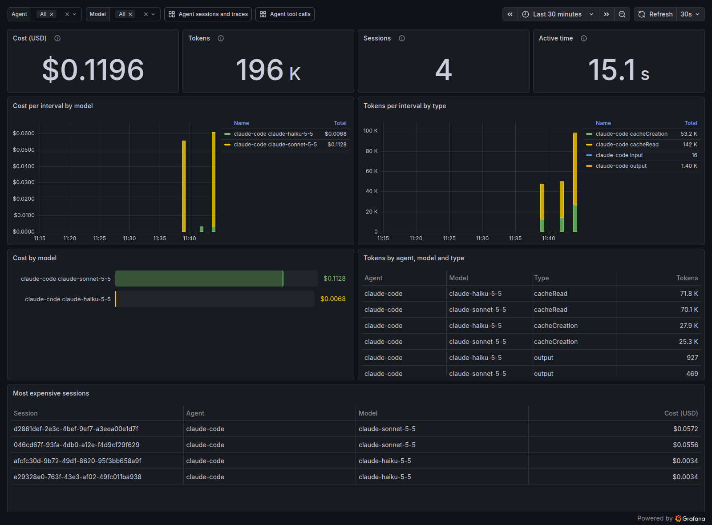
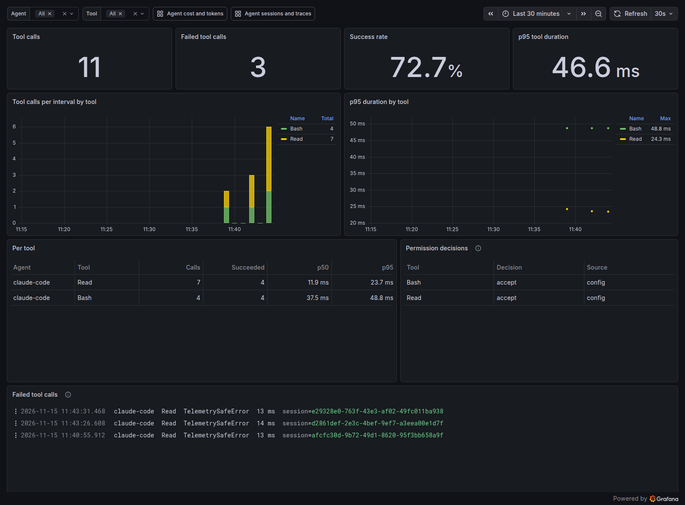

# agent-otel-kit

See the cost, tokens, tool calls and traces of Claude Code, Codex and Gemini CLI on your own machine, with one `docker compose up`.

[한국어](#한국어)



agent-otel-kit is a local OpenTelemetry stack for AI coding agents: an OpenTelemetry Collector that receives the agents' OTLP telemetry, Prometheus for metrics, Loki for events, Tempo for traces, and the same three dashboards in Grafana and in Perses. A small Go CLI points each agent at the collector and checks that data arrives.

## Quickstart (30 seconds)

Requirements: Docker with the compose plugin, Go 1.24+ for the CLI.

```sh
git clone https://github.com/s3onghyun/agent-otel-kit && cd agent-otel-kit
docker compose up -d                       # or: make up
make build                                 # builds bin/agent-otel-kit
bin/agent-otel-kit setup claude            # or codex, gemini, all
# start a new agent session and use it for a minute, then:
bin/agent-otel-kit doctor
```

Open Grafana at <http://localhost:3000> (anonymous read access; the dashboards are in the "Agent OTel Kit" folder). For Perses, run `docker compose --profile perses up -d` and open <http://localhost:8080>.

Every port is bound to 127.0.0.1. The collector listens on `localhost:4318` (OTLP/HTTP) and `localhost:4317` (OTLP/gRPC).

## What is collected and what is not

Collected: the metrics, events and traces each agent exports when telemetry is on: cost (Claude Code only), token counts by type, sessions, active time, tool calls with name, success, duration and permission decision, model request duration, and trace spans for each prompt, model request and tool call.

Not collected by default:

- Prompt text, model responses, tool arguments, tool output, file paths, shell commands and error messages. The agents already redact most of these unless you opt in (`OTEL_LOG_USER_PROMPTS`, `OTEL_LOG_TOOL_DETAILS`, Codex `log_user_prompt`, Gemini `logPrompts`). The collector deletes these attributes again in `transform/redact`, so turning one of those agent switches on by mistake does not store content. Set `AGENT_OTEL_KIT_CAPTURE_CONTENT=true` in the collector's environment to keep them.
- `user.email`. Claude Code and Gemini CLI attach the account email to every data point; the collector drops it unless `AGENT_OTEL_KIT_KEEP_EMAIL=true`.
- `setup gemini` sets `logPrompts: false`, because Gemini CLI logs prompts by default.

Other identifiers stay: `session.id`, `user.account_uuid`, `organization.id`, `terminal.type`, host OS. Everything stays on your machine; nothing in the stack sends data elsewhere (Grafana and Loki usage reporting is off).

## Per-agent setup

`setup` edits only the agent's own user config file. The first run saves the original file under `~/.agent-otel-kit/backups/`; `setup --undo <agent>` puts back the exact original bytes and permissions, or deletes the file (and any directory) that setup created. If you edited the file after setup, undo refuses unless you pass `--force`. `--dry-run` prints the result without writing. `--endpoint` points agents at a collector elsewhere (default `http://localhost:4318`).

| Agent | File | What setup writes |
|---|---|---|
| Claude Code | `~/.claude/settings.json` (`$CLAUDE_CONFIG_DIR` honoured) | `env`: `CLAUDE_CODE_ENABLE_TELEMETRY=1`, OTLP exporters for metrics and logs, `OTEL_EXPORTER_OTLP_ENDPOINT`, `http/protobuf`, a 10 s metric interval, and the traces beta (`OTEL_TRACES_EXPORTER=otlp`, `CLAUDE_CODE_ENHANCED_TELEMETRY_BETA=1`; skip with `--no-traces`) |
| Codex | `~/.codex/config.toml` (`$CODEX_HOME` honoured) | a marked block under `[otel]`: `exporter`, `trace_exporter` and `metrics_exporter` as `otlp-http` with the `/v1/logs`, `/v1/traces`, `/v1/metrics` URLs, `log_user_prompt = false`; other `[otel]` keys and the rest of the file are kept |
| Gemini CLI | `~/.gemini/settings.json` | `telemetry`: `enabled`, `target: "local"`, `otlpEndpoint`, `otlpProtocol: "http"`, `logPrompts: false`; removes `outfile`, which would override the endpoint |

Settings files with comments are not edited (setup stops with an error); add the block by hand in that case.

Supported versions:

| Agent | Status |
|---|---|
| Claude Code 2.1.325 | Verified on a live stack: metrics, events and traces (with the traces beta flag). |
| Codex | Config edit unit-tested against fixtures, written from the Codex `[otel]` docs. Not run against a live Codex yet. Codex exports no token or cost metric, so its token panels stay empty; tool calls come from `codex.tool_result` events. |
| Gemini CLI | Config edit unit-tested against fixtures, written from the Gemini CLI telemetry docs. Not run against a live Gemini CLI yet. Gemini CLI exports no cost metric. |

## The delta temporality trap

Claude Code, Codex and Gemini CLI export counters with delta temporality by default (each export carries only the increase since the last one), and Prometheus only stores cumulative counters, so a plain OTLP-to-Prometheus path drops or misreads them. The collector's `delta_to_cumulative` processor keeps a running total per series before the Prometheus exporter, so the agents can keep their defaults.

Two related Prometheus settings in `compose.yaml`: `created-timestamp-zero-ingestion` inserts a zero sample when a series starts, so a short session's first export is counted, and `promql-extended-range-selectors` enables `increase(x[$__range] anchored)`, which the dashboards use for exact totals without `increase()`'s extrapolation.

## Dashboards

All three exist in Grafana (`grafana/dashboards/`) and Perses (`perses/provisioning/dashboards/`). Both are generated from one panel list in `tools/gendashboards` (`make dashboards`); CI fails if the committed JSON differs.

**Agent cost and tokens**: cost, tokens, sessions and active time for the range; cost per interval by model; tokens per interval by type; cost by model; tokens by agent, model and type; the most expensive sessions.

**Agent tool calls**: call count, failures, success rate and p95 duration; calls per interval and p95 duration by tool; a per-tool table; permission decisions (who allowed each call); failed calls from Loki. The tool metric `agent_otel_kit.tool.duration` is built in the collector by the `signal_to_metrics` connector from each agent's tool result events, so it is the same for all agents.



**Agent sessions and traces**: per-session cost and tokens, the interaction traces from Tempo, a trace waterfall (paste a trace ID into the Trace ID box), model request duration, event rate by type, and the event stream of the selected sessions.


Every label is normalized to `agent_name` (`claude-code`, `codex`, `gemini-cli`), derived from the `service.name` each agent sets. Set `OTEL_RESOURCE_ATTRIBUTES=agent.name=<name>` on an agent to override it. Claude Code's own `agent.name` attribute (the subagent name) is kept as `subagent.name`.

Metric names seen in Prometheus from Claude Code 2.1.325: `claude_code_cost_usage_USD_total`, `claude_code_token_usage_tokens_total`, `claude_code_session_count_total`, `claude_code_active_time_seconds_total`; from the collector: `agent_otel_kit_tool_duration_milliseconds_{bucket,count,sum}`. Claude Code also defines `claude_code.lines_of_code.count`, `claude_code.commit.count`, `claude_code.pull_request.count` and `claude_code.code_edit_tool.decision`, which only appear after edits, commits or pull requests.

The screenshots were taken from this stack with real Claude Code sessions run on the author's machine (`make demo`, `make screenshots`).

## Perses

```sh
docker compose --profile perses up -d      # or: make up-perses
```

Perses starts on <http://localhost:8080> with the project `agent-otel-kit`, global datasources for Prometheus, Loki and Tempo, and the three dashboards, all loaded from `perses/provisioning/` (re-read every 30 s). The dashboards are plain Perses resources (`kind: Dashboard`) and can also be applied to another Perses server with `percli apply -d perses/provisioning/dashboards/`.


## Troubleshooting

- `agent-otel-kit doctor` prints one line per check: stack health, whether the collector has received anything (from its own `otelcol_receiver_accepted_*` counters), which `agent_name` values have metrics in Prometheus, and whether each agent config points at the collector.
- Loki and Tempo answer 503 for up to a minute after `docker compose up`.
- Nothing arrives: telemetry settings are read at agent start, so start a new session after `setup`. A shell variable such as `OTEL_EXPORTER_OTLP_ENDPOINT` can point elsewhere; doctor warns about it. Claude Code ignores OTel exporter variables in project-level `.claude/settings.json`.
- Metrics arrive late: Claude Code exports metrics every 60 s unless `OTEL_METRIC_EXPORT_INTERVAL` is set (setup sets 10 s); events and spans export every 5 s.
- No traces from Claude Code: the traces beta needs `CLAUDE_CODE_ENHANCED_TELEMETRY_BETA=1` and `OTEL_TRACES_EXPORTER=otlp`.
- To see raw data, start with `make up-debug` and run `docker compose logs -f otel-collector`.
- Restarting the collector resets its delta-to-cumulative state; the dashboards treat that as a counter reset.
- Memory limits: collector, Prometheus, Loki and Tempo 512 MiB each, Grafana 384 MiB, Perses 256 MiB.
- `make clean` stops the stack and deletes its volumes.

## Layout

```
compose.yaml               the stack (Perses under --profile perses)
collector/config.yaml      receivers, processors, connector, exporters
prometheus/ loki/ tempo/   backend configs
grafana/                   datasources and dashboards
perses/                    Perses config and provisioning
cmd/agent-otel-kit/        CLI: setup, setup --undo, doctor
tools/gendashboards/       generates the Grafana and Perses dashboards
scripts/                   demo.sh (real claude -p sessions), screenshots.sh
```

License: Apache-2.0.

---

## 한국어

명령 한 줄(`docker compose up`)로 Claude Code·Codex·Gemini CLI의 비용, 토큰, 도구 호출, 트레이스를 내 컴퓨터에서 봅니다.

agent-otel-kit은 AI 코딩 에이전트용 로컬 OpenTelemetry 스택입니다. 에이전트의 OTLP 텔레메트리를 받는 OpenTelemetry Collector, 메트릭용 Prometheus, 이벤트용 Loki, 트레이스용 Tempo, 그리고 Grafana와 Perses에 같은 대시보드 3개가 들어 있습니다. 작은 Go CLI가 각 에이전트 설정을 collector로 향하게 하고 데이터가 들어오는지 확인합니다.

### 빠른 시작 (30초)

필요한 것: compose 플러그인이 있는 Docker, CLI 빌드용 Go 1.24 이상.

```sh
git clone https://github.com/s3onghyun/agent-otel-kit && cd agent-otel-kit
docker compose up -d                       # 또는 make up
make build                                 # bin/agent-otel-kit 생성
bin/agent-otel-kit setup claude            # codex, gemini, all도 가능
# 에이전트 세션을 새로 시작해 1분쯤 쓴 뒤:
bin/agent-otel-kit doctor
```

Grafana는 <http://localhost:3000>입니다(익명 읽기 허용, 대시보드는 "Agent OTel Kit" 폴더). Perses는 `docker compose --profile perses up -d` 후 <http://localhost:8080>에서 엽니다.

모든 포트는 127.0.0.1에만 열립니다. collector는 `localhost:4318`(OTLP/HTTP)과 `localhost:4317`(OTLP/gRPC)에서 받습니다.

### 수집하는 것과 수집하지 않는 것

수집: 텔레메트리를 켠 에이전트가 내보내는 메트릭, 이벤트, 트레이스입니다. 비용(Claude Code만), 유형별 토큰 수, 세션, 활동 시간, 도구 호출(이름, 성공 여부, 소요 시간, 권한 결정), 모델 요청 시간, 프롬프트·모델 요청·도구 호출별 span입니다.

기본으로 수집하지 않는 것:

- 프롬프트 내용, 모델 응답, 도구 인자, 도구 출력, 파일 경로, 셸 명령, 오류 메시지. 에이전트도 옵트인(`OTEL_LOG_USER_PROMPTS`, `OTEL_LOG_TOOL_DETAILS`, Codex `log_user_prompt`, Gemini `logPrompts`)하지 않으면 대부분 가립니다. collector의 `transform/redact`가 이 속성들을 한 번 더 지우므로, 에이전트 쪽 스위치를 실수로 켜도 내용은 저장되지 않습니다. 남기려면 collector 환경 변수 `AGENT_OTEL_KIT_CAPTURE_CONTENT=true`를 설정합니다.
- `user.email`. Claude Code와 Gemini CLI는 모든 데이터에 계정 이메일을 붙이는데, collector가 지웁니다. 남기려면 `AGENT_OTEL_KIT_KEEP_EMAIL=true`입니다.
- Gemini CLI는 기본값으로 프롬프트를 기록하므로 `setup gemini`가 `logPrompts: false`를 씁니다.

남는 식별자: `session.id`, `user.account_uuid`, `organization.id`, `terminal.type`, 호스트 OS. 모든 데이터는 내 컴퓨터에만 있고, 스택이 외부로 보내는 것은 없습니다(Grafana와 Loki 사용 통계 전송은 꺼 두었습니다).

### 에이전트별 설정

`setup`은 각 에이전트의 사용자 설정 파일만 고칩니다. 처음 실행할 때 원본을 `~/.agent-otel-kit/backups/`에 저장하고, `setup --undo <agent>`는 원본 바이트와 권한을 그대로 되돌립니다. setup이 새로 만든 파일과 디렉터리는 지웁니다. setup 이후 파일을 손으로 고쳤다면 `--force` 없이는 되돌리지 않습니다. `--dry-run`은 쓰지 않고 결과만 출력하고, `--endpoint`로 다른 collector를 지정합니다(기본 `http://localhost:4318`).

| 에이전트 | 파일 | setup이 쓰는 내용 |
|---|---|---|
| Claude Code | `~/.claude/settings.json` (`$CLAUDE_CONFIG_DIR` 지원) | `env`: `CLAUDE_CODE_ENABLE_TELEMETRY=1`, 메트릭·로그 OTLP exporter, `OTEL_EXPORTER_OTLP_ENDPOINT`, `http/protobuf`, 메트릭 주기 10초, 트레이스 베타(`OTEL_TRACES_EXPORTER=otlp`, `CLAUDE_CODE_ENHANCED_TELEMETRY_BETA=1`, `--no-traces`로 생략) |
| Codex | `~/.codex/config.toml` (`$CODEX_HOME` 지원) | `[otel]` 아래 표시된 블록: `exporter`, `trace_exporter`, `metrics_exporter`를 `otlp-http`와 `/v1/logs`, `/v1/traces`, `/v1/metrics` URL로, `log_user_prompt = false`. 다른 `[otel]` 키와 나머지 파일은 그대로 둡니다 |
| Gemini CLI | `~/.gemini/settings.json` | `telemetry`: `enabled`, `target: "local"`, `otlpEndpoint`, `otlpProtocol: "http"`, `logPrompts: false`. endpoint를 덮어쓰는 `outfile`은 지웁니다 |

주석이 있는 설정 파일은 고치지 않고 오류로 멈춥니다. 이때는 블록을 직접 추가합니다.

지원 버전:

| 에이전트 | 상태 |
|---|---|
| Claude Code 2.1.325 | 실제 스택에서 확인: 메트릭, 이벤트, 트레이스(트레이스 베타 플래그 사용). |
| Codex | Codex `[otel]` 문서대로 작성하고 fixture로 설정 편집을 단위 테스트했습니다. 실제 Codex로는 아직 돌려 보지 않았습니다. Codex는 토큰·비용 메트릭을 내보내지 않아 토큰 패널이 비고, 도구 호출은 `codex.tool_result` 이벤트에서 만듭니다. |
| Gemini CLI | Gemini CLI 텔레메트리 문서대로 작성하고 fixture로 설정 편집을 단위 테스트했습니다. 실제 Gemini CLI로는 아직 돌려 보지 않았습니다. Gemini CLI는 비용 메트릭을 내보내지 않습니다. |

### delta temporality 함정

Claude Code, Codex, Gemini CLI는 기본적으로 카운터를 delta temporality로 내보내는데(매번 지난 전송 이후 증가분만 보냄), Prometheus는 누적(cumulative) 카운터만 저장하기 때문에 OTLP를 그대로 Prometheus로 보내면 값이 버려지거나 잘못 읽힙니다. collector의 `delta_to_cumulative` processor가 Prometheus exporter 앞에서 시계열별 누적 합계를 유지하므로 에이전트 기본값을 바꿀 필요가 없습니다.

`compose.yaml`의 관련 Prometheus 설정 두 가지: `created-timestamp-zero-ingestion`은 시계열이 시작될 때 0 샘플을 넣어 짧은 세션의 첫 전송도 셉니다. `promql-extended-range-selectors`는 `increase(x[$__range] anchored)`를 쓸 수 있게 해서, 대시보드가 `increase()`의 외삽 없이 정확한 합계를 보여 줍니다.

### 대시보드

세 대시보드 모두 Grafana(`grafana/dashboards/`)와 Perses(`perses/provisioning/dashboards/`)에 있습니다. 둘 다 `tools/gendashboards`의 패널 목록 하나에서 생성하며(`make dashboards`), 커밋된 JSON이 다르면 CI가 실패합니다.

**Agent cost and tokens**: 기간 내 비용, 토큰, 세션, 활동 시간; 모델별 구간 비용; 유형별 구간 토큰; 모델별 비용; 에이전트·모델·유형별 토큰; 비용이 큰 세션.

**Agent tool calls**: 호출 수, 실패 수, 성공률, p95 소요 시간; 도구별 구간 호출 수와 p95; 도구별 표; 권한 결정(누가 호출을 허용했는지); Loki의 실패 호출 목록. 도구 메트릭 `agent_otel_kit.tool.duration`은 collector의 `signal_to_metrics` connector가 각 에이전트의 도구 결과 이벤트로 만들어서 에이전트마다 같은 형태입니다.

**Agent sessions and traces**: 세션별 비용과 토큰, Tempo의 interaction 트레이스, 트레이스 워터폴(Trace ID 칸에 ID 입력), 모델 요청 시간, 유형별 이벤트 수, 선택한 세션의 이벤트 흐름.

모든 레이블은 각 에이전트가 설정하는 `service.name`에서 만든 `agent_name`(`claude-code`, `codex`, `gemini-cli`)으로 통일합니다. 바꾸려면 에이전트에 `OTEL_RESOURCE_ATTRIBUTES=agent.name=<이름>`을 설정합니다. Claude Code 자체의 `agent.name` 속성(서브에이전트 이름)은 `subagent.name`으로 남습니다.

Claude Code 2.1.325에서 Prometheus에 실제로 들어온 메트릭 이름: `claude_code_cost_usage_USD_total`, `claude_code_token_usage_tokens_total`, `claude_code_session_count_total`, `claude_code_active_time_seconds_total`. collector가 만드는 것: `agent_otel_kit_tool_duration_milliseconds_{bucket,count,sum}`. Claude Code에는 `claude_code.lines_of_code.count`, `claude_code.commit.count`, `claude_code.pull_request.count`, `claude_code.code_edit_tool.decision`도 있지만 편집, 커밋, PR이 있어야 나타납니다.

스크린샷은 작성자 컴퓨터에서 실제 Claude Code 세션을 돌린 이 스택에서 찍었습니다(`make demo`, `make screenshots`).

### Perses

```sh
docker compose --profile perses up -d      # 또는 make up-perses
```

Perses가 <http://localhost:8080>에서 `agent-otel-kit` 프로젝트, Prometheus·Loki·Tempo 전역 데이터소스, 대시보드 3개와 함께 뜹니다. 모두 `perses/provisioning/`에서 읽습니다(30초마다 다시 읽음). 대시보드는 일반 Perses 리소스(`kind: Dashboard`)라서 `percli apply -d perses/provisioning/dashboards/`로 다른 Perses 서버에도 올릴 수 있습니다.

### 문제 해결

- `agent-otel-kit doctor`는 검사마다 한 줄씩 출력합니다: 스택 상태, collector가 받은 데이터가 있는지(collector 자체의 `otelcol_receiver_accepted_*` 카운터), Prometheus에 메트릭이 있는 `agent_name` 값, 각 에이전트 설정이 collector를 가리키는지.
- Loki와 Tempo는 `docker compose up` 후 최대 1분 동안 503을 반환합니다.
- 데이터가 안 들어올 때: 텔레메트리 설정은 에이전트 시작 시 읽으므로 `setup` 후 세션을 새로 시작합니다. `OTEL_EXPORTER_OTLP_ENDPOINT` 같은 셸 변수가 다른 곳을 가리킬 수 있고, doctor가 경고합니다. Claude Code는 프로젝트의 `.claude/settings.json`에 있는 OTel exporter 변수를 무시합니다.
- 메트릭이 늦게 들어올 때: Claude Code는 `OTEL_METRIC_EXPORT_INTERVAL`이 없으면 60초마다 메트릭을 보냅니다(setup은 10초로 설정). 이벤트와 span은 5초마다 보냅니다.
- Claude Code 트레이스가 없을 때: 트레이스 베타는 `CLAUDE_CODE_ENHANCED_TELEMETRY_BETA=1`과 `OTEL_TRACES_EXPORTER=otlp`가 필요합니다.
- 원본 데이터를 보려면 `make up-debug`로 띄우고 `docker compose logs -f otel-collector`를 봅니다.
- collector를 재시작하면 delta→cumulative 상태가 초기화되고, 대시보드는 이를 카운터 리셋으로 처리합니다.
- 메모리 상한: collector, Prometheus, Loki, Tempo 각 512 MiB, Grafana 384 MiB, Perses 256 MiB.
- `make clean`은 스택을 멈추고 볼륨을 지웁니다.

라이선스: Apache-2.0.
