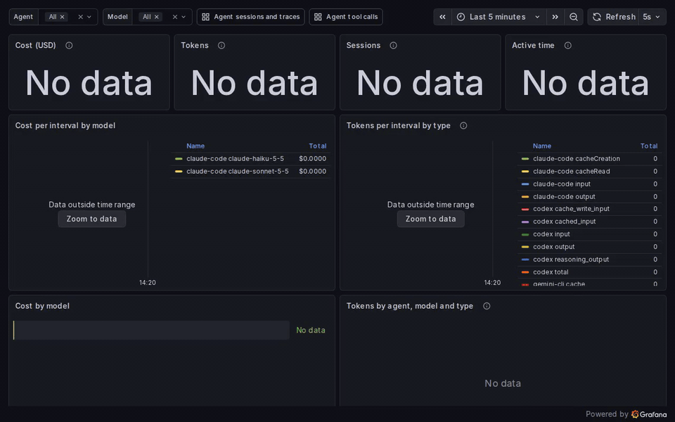
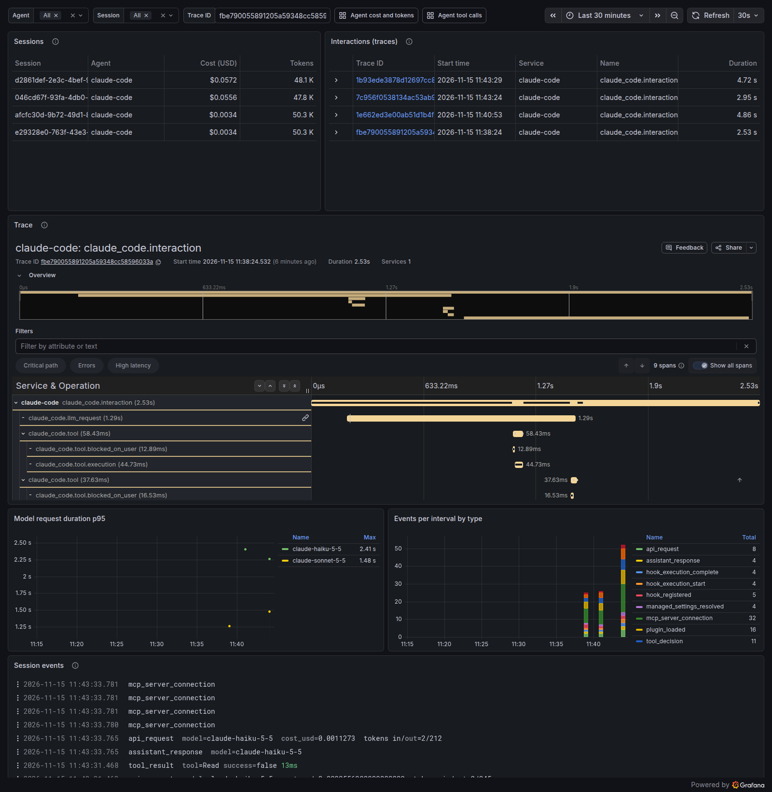
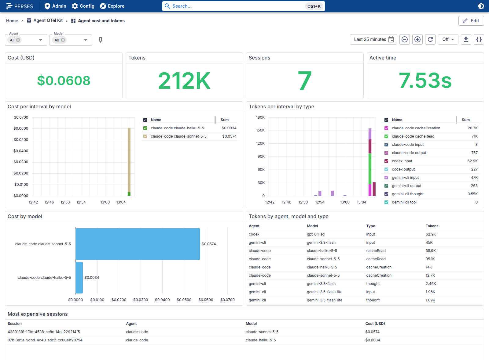

# agent-otel-kit

See the cost, tokens, tool calls and traces of Claude Code, Codex and Gemini CLI on your own machine, with one `docker compose up`.



[한국어](#한국어)

agent-otel-kit is a local OpenTelemetry stack for AI coding agents: an OpenTelemetry Collector that receives the agents' OTLP telemetry, Prometheus for metrics, Loki for events, Tempo for traces, and the same three dashboards in Grafana and in Perses. A small Go CLI points each agent at the collector and checks that data arrives.

## Quickstart (30 seconds)

Requirements: Docker with the compose plugin, and the CLI (see [Install the CLI](#install-the-cli)).

```sh
git clone https://github.com/s3onghyun/agent-otel-kit && cd agent-otel-kit
docker compose up -d                       # or: make up
brew install s3onghyun/tap/agent-otel-kit  # or a release archive, go install, or make build
agent-otel-kit setup claude                # or codex, gemini, all
# start a new agent session and use it for a minute, then:
agent-otel-kit doctor
```

Open Grafana at <http://localhost:3000> (anonymous read access; the dashboards are in the "Agent OTel Kit" folder). For Perses, run `docker compose --profile perses up -d` and open <http://localhost:8080>.

Every port is bound to 127.0.0.1. The collector listens on `localhost:4318` (OTLP/HTTP) and `localhost:4317` (OTLP/gRPC).

### Install the CLI

- Homebrew (macOS, Linux): `brew install s3onghyun/tap/agent-otel-kit`
- Prebuilt archives for Linux and macOS (amd64, arm64) with `checksums.txt`: [Releases](https://github.com/s3onghyun/agent-otel-kit/releases)
- Go 1.24+: `go install github.com/s3onghyun/agent-otel-kit/cmd/agent-otel-kit@latest`
- From the clone: `make build` writes `bin/agent-otel-kit`

`agent-otel-kit version` prints the version, commit and build date.

## What is collected and what is not

Collected: the metrics, events and traces each agent exports when telemetry is on: cost (Claude Code only), token counts by type, sessions, active time, tool calls with name, success, duration and permission decision, model request duration, and trace spans for each prompt, model request and tool call.

Not collected by default:

- Prompt text, model responses, tool arguments, tool output, file paths, shell commands and error messages (including `error.message` and span exception messages, which can hold file paths). The agents already redact most of these unless you opt in (`OTEL_LOG_USER_PROMPTS`, `OTEL_LOG_TOOL_DETAILS`, Codex `log_user_prompt`, Gemini `logPrompts`). The collector deletes these attributes again in `transform/redact`, so turning one of those agent switches on by mistake does not store content. Set `AGENT_OTEL_KIT_CAPTURE_CONTENT=true` in the collector's environment to keep them.
- The process command line (`process.command_args`). Gemini CLI sends it as a resource attribute, and for `gemini -p "..."` it contains the prompt.
- `user.email`. Claude Code attaches the account email to every data point, and Gemini CLI documents the same for Google sign-in (with an API key it sent none); the collector drops it unless `AGENT_OTEL_KIT_KEEP_EMAIL=true`.
- `setup gemini` sets `logPrompts: false`, because Gemini CLI logs prompts by default.

Other identifiers stay: `session.id` (Codex: `conversation.id`), `user.account_uuid`, `organization.id`, Codex `user.account_id`, `installation.id`, `terminal.type`, host name and OS. Everything stays on your machine; nothing in the stack sends data elsewhere (Grafana and Loki usage reporting is off).

## Per-agent setup

`setup` edits only the agent's own user config file. The first run saves the original file under `~/.agent-otel-kit/backups/`; `setup --undo <agent>` puts back the exact original bytes and permissions, or deletes the file (and any directory) that setup created. If you edited the file after setup, undo refuses unless you pass `--force`. `--dry-run` prints the result without writing. `--endpoint` points agents at a collector elsewhere (default `http://localhost:4318`).

| Agent | File | What setup writes |
|---|---|---|
| Claude Code | `~/.claude/settings.json` (`$CLAUDE_CONFIG_DIR` honoured) | `env`: `CLAUDE_CODE_ENABLE_TELEMETRY=1`, OTLP exporters for metrics and logs, `OTEL_EXPORTER_OTLP_ENDPOINT`, `http/protobuf`, a 10 s metric interval, and the traces beta (`OTEL_TRACES_EXPORTER=otlp`, `CLAUDE_CODE_ENHANCED_TELEMETRY_BETA=1`; skip with `--no-traces`) |
| Codex | `~/.codex/config.toml` (`$CODEX_HOME` honoured) | a marked block under `[otel]`: `exporter`, `trace_exporter` and `metrics_exporter` as `otlp-http` with the `/v1/logs`, `/v1/traces`, `/v1/metrics` URLs, `log_user_prompt = false`; other `[otel]` keys and the rest of the file are kept |
| Gemini CLI | `~/.gemini/settings.json` | `telemetry`: `enabled`, `target: "local"`, `otlpEndpoint`, `otlpProtocol: "http"`, `logPrompts: false`; removes `outfile`, which would override the endpoint |

Settings files with comments are not edited (setup stops with an error); add the block by hand in that case.

Supported versions:

| Agent | Status |
|---|---|
| Claude Code 2.1.325 | Verified on a live stack: metrics, events and traces (with the traces beta flag). |
| Codex 0.169.0 (`codex exec`) | Verified on a live stack with `setup codex`: metrics, events and traces. Tokens come from the `codex.turn.token_usage` histogram, sessions from `codex.thread.started`, tool calls from `codex.tool_result` events. No cost metric. Codex metrics carry no session ID, so Codex sessions are missing from the per-session table. |
| Gemini CLI 0.68.0 (`gemini -p`, API key) | Verified on a live stack with `setup gemini`: metrics, events and traces. Tool calls come from `gemini_cli.tool_call` events. No cost metric. |

Only the non-interactive modes and the auth methods listed were run. Gemini CLI with a personal Google login was rejected by Google for this client ("no longer supported for Gemini Code Assist for individuals"), so that path was tested with an AI Studio API key.

## The delta temporality trap

Claude Code, Codex and Gemini CLI export counters with delta temporality by default (each export carries only the increase since the last one), and Prometheus only stores cumulative counters, so a plain OTLP-to-Prometheus path drops or misreads them. The collector's `delta_to_cumulative` processor keeps a running total per series before the Prometheus exporter, so the agents can keep their defaults.

Two related Prometheus settings in `compose.yaml`: `created-timestamp-zero-ingestion` inserts a zero sample when a series starts, so a short session's first export is counted, and `promql-extended-range-selectors` enables `increase(x[$__range] anchored)`, which the dashboards use for exact totals without `increase()`'s extrapolation.

## Dashboards

All three exist in Grafana (`grafana/dashboards/`) and Perses (`perses/provisioning/dashboards/`). Both are generated from one panel list in `tools/gendashboards` (`make dashboards`); CI fails if the committed JSON differs.

**Agent cost and tokens**: cost, tokens, sessions and active time for the range; cost per interval by model; tokens per interval by type; cost by model; tokens by agent, model and type; the most expensive sessions.

**Agent tool calls**: call count, failures, success rate and p95 duration; calls per interval and p95 duration by tool; a per-tool table; permission decisions (who allowed each call); failed calls from Loki. The tool metric `agent_otel_kit.tool.duration` is built in the collector by the `signal_to_metrics` connector from each agent's tool result events, so it is the same for all agents.


**Agent sessions and traces**: per-session cost and tokens, the interaction traces from Tempo, a trace waterfall (paste a trace ID into the Trace ID box), model request duration, event rate by type, and the event stream of the selected sessions.



Every label is normalized to `agent_name` (`claude-code`, `codex`, `gemini-cli`), derived from the `service.name` each agent sets. Set `OTEL_RESOURCE_ATTRIBUTES=agent.name=<name>` on an agent to override it. Claude Code's own `agent.name` attribute (the subagent name) and Codex's `agent_name` attribute (the agent path, `/root` for the main agent) are kept as `subagent.name`. Codex's `conversation.id` is copied to `session.id`, and its `token_type` to `type`.

Token totals (the Tokens stat and the per-session Tokens column) add only token types that do not overlap: Codex counts cached input inside `input` and reasoning inside `output`, and Gemini CLI counts `cache` inside `input`, so those parts (and Codex's `total`) are not added again. Claude Code's `cacheRead` and `cacheCreation` are separate from `input` and are added. The per-type breakdowns show every type, including the overlapping ones.

Agent differences visible on the dashboards:

- Codex marks a shell command that ran but exited non-zero as a successful tool call. In code mode it also reports the outer `exec` tool next to each inner `exec_command`.
- Codex sends many short internal traces (`auth`, `fs.read_file`, ...); the traces panel lists only `turn/start` for Codex. Gemini CLI has no per-prompt trace: it sends one `llm_call` trace per model call and one `schedule_tool_calls` trace per tool batch.
- Over its default WebSocket transport, Codex logs no per-request model duration, so the model request panel shows Codex only for HTTP `/responses` requests.

Metric names seen in Prometheus from Claude Code 2.1.325: `claude_code_cost_usage_USD_total`, `claude_code_token_usage_tokens_total`, `claude_code_session_count_total`, `claude_code_active_time_seconds_total`. From Codex 0.169.0 (74 metric families in a short `codex exec` run), among them: `codex_turn_token_usage_{bucket,count,sum}` (label `token_type`), `codex_thread_started_total`, `codex_tool_call_total`, `codex_turn_e2e_duration_ms_milliseconds_*`. From Gemini CLI 0.68.0: `gemini_cli_token_usage_total` (label `type`: `input`, `output`, `thought`, `cache`, `tool`), `gemini_cli_session_count_total`, `gemini_cli_tool_call_count_total`, `gemini_cli_api_request_count_total`. From the collector: `agent_otel_kit_tool_duration_milliseconds_{bucket,count,sum}`.

Event names seen in Loki: Claude Code `tool_result`, `tool_decision`, `api_request`, `user_prompt`, ...; Codex `codex.tool_result`, `codex.tool_decision`, `codex.sse_event`, `codex.api_request`, `codex.user_prompt`, ...; Gemini CLI `gemini_cli.tool_call`, `gemini_cli.api_request`, `gemini_cli.api_response`, `gemini_cli.file_operation`, `gemini_cli.user_prompt`, .... Claude Code also defines `claude_code.lines_of_code.count`, `claude_code.commit.count`, `claude_code.pull_request.count` and `claude_code.code_edit_tool.decision`, which only appear after edits, commits or pull requests.

The screenshots were taken from this stack with real sessions run on the author's machine: Claude Code (`make demo`), `codex exec` and `gemini -p`, then `make screenshots`. The demo GIF at the top is a headless Chromium recording of the same dashboards during one such run, only trimmed and sped up; `docs/demo.mp4` is its source.

## Perses

```sh
docker compose --profile perses up -d      # or: make up-perses
```

Perses starts on <http://localhost:8080> with the project `agent-otel-kit`, global datasources for Prometheus, Loki and Tempo, and the three dashboards, all loaded from `perses/provisioning/` (re-read every 30 s). The dashboards are plain Perses resources (`kind: Dashboard`) and can also be applied to another Perses server with `percli apply -d perses/provisioning/dashboards/`.



## Troubleshooting

- `agent-otel-kit doctor` prints one line per check: stack health, whether the collector has received anything (from its own `otelcol_receiver_accepted_*` counters), which `agent_name` values have metrics in Prometheus, and whether each agent config points at the collector.
- Loki and Tempo answer 503 for up to a minute after `docker compose up`.
- Nothing arrives: telemetry settings are read at agent start, so start a new session after `setup`. A shell variable such as `OTEL_EXPORTER_OTLP_ENDPOINT` can point elsewhere; doctor warns about it. Claude Code ignores OTel exporter variables in project-level `.claude/settings.json`.
- Metrics arrive late: Claude Code exports metrics every 60 s unless `OTEL_METRIC_EXPORT_INTERVAL` is set (setup sets 10 s); events and spans export every 5 s.
- No traces from Claude Code: the traces beta needs `CLAUDE_CODE_ENHANCED_TELEMETRY_BETA=1` and `OTEL_TRACES_EXPORTER=otlp`.
- To see raw data, start with `make up-debug` and run `docker compose logs -f otel-collector`.
- `make test-collector` runs the collector config against payloads recorded from Codex and Gemini CLI (in `collector/testdata/`) and checks the normalization, the tool histogram and the redaction.
- Restarting the collector resets its delta-to-cumulative state; the dashboards treat that as a counter reset.
- Memory limits: collector, Prometheus, Loki and Tempo 512 MiB each, Grafana 384 MiB, Perses 256 MiB.
- `make clean` stops the stack and deletes its volumes.

## Layout

```
compose.yaml               the stack (Perses under --profile perses)
collector/config.yaml      receivers, processors, connector, exporters
prometheus/ loki/ tempo/   backend configs
grafana/                   datasources and dashboards
perses/                    Perses config and provisioning
cmd/agent-otel-kit/        CLI: setup, setup --undo, doctor, version
.goreleaser.yaml           release builds (a vX.Y.Z tag runs .github/workflows/release.yml)
tools/gendashboards/       generates the Grafana and Perses dashboards
scripts/                   demo.sh (real claude -p sessions), screenshots.sh,
                           test-collector.sh (collector rules on recorded payloads)
```

License: Apache-2.0.

---

## 한국어

명령 한 줄(`docker compose up`)로 Claude Code·Codex·Gemini CLI의 비용, 토큰, 도구 호출, 트레이스를 내 컴퓨터에서 봅니다.


agent-otel-kit은 AI 코딩 에이전트용 로컬 OpenTelemetry 스택입니다. 에이전트의 OTLP 텔레메트리를 받는 OpenTelemetry Collector, 메트릭용 Prometheus, 이벤트용 Loki, 트레이스용 Tempo, 그리고 Grafana와 Perses에 같은 대시보드 3개가 들어 있습니다. 작은 Go CLI가 각 에이전트 설정을 collector로 향하게 하고 데이터가 들어오는지 확인합니다.

### 빠른 시작 (30초)

필요한 것: compose 플러그인이 있는 Docker, 그리고 CLI([CLI 설치](#cli-설치) 참고).

```sh
git clone https://github.com/s3onghyun/agent-otel-kit && cd agent-otel-kit
docker compose up -d                       # 또는 make up
brew install s3onghyun/tap/agent-otel-kit  # 또는 릴리스 압축 파일, go install, make build
agent-otel-kit setup claude                # codex, gemini, all도 가능
# 에이전트 세션을 새로 시작해 1분쯤 쓴 뒤:
agent-otel-kit doctor
```

Grafana는 <http://localhost:3000>입니다(익명 읽기 허용, 대시보드는 "Agent OTel Kit" 폴더). Perses는 `docker compose --profile perses up -d` 후 <http://localhost:8080>에서 엽니다.

모든 포트는 127.0.0.1에만 열립니다. collector는 `localhost:4318`(OTLP/HTTP)과 `localhost:4317`(OTLP/gRPC)에서 받습니다.

### CLI 설치

- Homebrew(macOS, Linux): `brew install s3onghyun/tap/agent-otel-kit`
- Linux·macOS(amd64, arm64)용 빌드 파일과 `checksums.txt`: [Releases](https://github.com/s3onghyun/agent-otel-kit/releases)
- Go 1.24 이상: `go install github.com/s3onghyun/agent-otel-kit/cmd/agent-otel-kit@latest`
- 클론한 저장소에서: `make build`가 `bin/agent-otel-kit`을 만듭니다

`agent-otel-kit version`은 버전, 커밋, 빌드 날짜를 출력합니다.

### 수집하는 것과 수집하지 않는 것

수집: 텔레메트리를 켠 에이전트가 내보내는 메트릭, 이벤트, 트레이스입니다. 비용(Claude Code만), 유형별 토큰 수, 세션, 활동 시간, 도구 호출(이름, 성공 여부, 소요 시간, 권한 결정), 모델 요청 시간, 프롬프트·모델 요청·도구 호출별 span입니다.

기본으로 수집하지 않는 것:

- 프롬프트 내용, 모델 응답, 도구 인자, 도구 출력, 파일 경로, 셸 명령, 오류 메시지(파일 경로가 들어갈 수 있는 `error.message`와 span 예외 메시지 포함). 에이전트도 옵트인(`OTEL_LOG_USER_PROMPTS`, `OTEL_LOG_TOOL_DETAILS`, Codex `log_user_prompt`, Gemini `logPrompts`)하지 않으면 대부분 가립니다. collector의 `transform/redact`가 이 속성들을 한 번 더 지우므로, 에이전트 쪽 스위치를 실수로 켜도 내용은 저장되지 않습니다. 남기려면 collector 환경 변수 `AGENT_OTEL_KIT_CAPTURE_CONTENT=true`를 설정합니다.
- 프로세스 명령줄(`process.command_args`). Gemini CLI가 resource 속성으로 보내는데, `gemini -p "..."`로 실행하면 프롬프트가 들어 있습니다.
- `user.email`. Claude Code는 모든 데이터에 계정 이메일을 붙이고, Gemini CLI도 Google 로그인 시 그렇다고 문서에 적혀 있습니다(API 키로는 보내지 않았습니다). collector가 지웁니다. 남기려면 `AGENT_OTEL_KIT_KEEP_EMAIL=true`입니다.
- Gemini CLI는 기본값으로 프롬프트를 기록하므로 `setup gemini`가 `logPrompts: false`를 씁니다.

남는 식별자: `session.id`(Codex는 `conversation.id`), `user.account_uuid`, `organization.id`, Codex `user.account_id`, `installation.id`, `terminal.type`, 호스트 이름과 OS. 모든 데이터는 내 컴퓨터에만 있고, 스택이 외부로 보내는 것은 없습니다(Grafana와 Loki 사용 통계 전송은 꺼 두었습니다).

### 에이전트별 설정

`setup`은 각 에이전트의 사용자 설정 파일만 고칩니다. 처음 실행할 때 원본을 `~/.agent-otel-kit/backups/`에 저장하고, `setup --undo <agent>`는 원본 바이트와 권한을 그대로 되돌립니다. setup이 새로 만든 파일과 디렉터리는 지웁니다. setup 이후 파일을 손으로 고쳤다면 `--force` 없이는 되돌리지 않습니다. `--dry-run`은 쓰지 않고 결과만 출력하고, `--endpoint`로 다른 collector를 지정합니다(기본 `http://localhost:4318`).

| 에이전트 | 파일 | setup이 쓰는 내용 |
|---|---|---|
| Claude Code | `~/.claude/settings.json` (`$CLAUDE_CONFIG_DIR` 지원) | `env`: `CLAUDE_CODE_ENABLE_TELEMETRY=1`, 메트릭·로그 OTLP exporter, `OTEL_EXPORTER_OTLP_ENDPOINT`, `http/protobuf`, 메트릭 주기 10초, 트레이스 베타(`OTEL_TRACES_EXPORTER=otlp`, `CLAUDE_CODE_ENHANCED_TELEMETRY_BETA=1`, `--no-traces`로 생략) |
| Codex | `~/.codex/config.toml` (`$CODEX_HOME` 지원) | `[otel]` 아래 표시된 블록: `exporter`, `trace_exporter`, `metrics_exporter`를 `otlp-http`와 `/v1/logs`, `/v1/traces`, `/v1/metrics` URL로, `log_user_prompt = false`. 다른 `[otel]` 키와 나머지 파일은 그대로 둡니다 |
| Gemini CLI | `~/.gemini/settings.json` | `telemetry`: `enabled`, `target: "local"`, `otlpEndpoint`, `otlpProtocol: "http"`, `logPrompts: false`. endpoint를 덮어쓰는 `outfile`은 지웁니다 |

주석이 있는 설정 파일은 고치지 않고 오류로 멈춥니다. 이때는 블록을 직접 추가합니다.

지원 버전:

| 에이전트 | 상태 |
|---|---|
| Claude Code 2.1.325 | 실제 스택에서 확인: 메트릭, 이벤트, 트레이스(트레이스 베타 플래그 사용). |
| Codex 0.169.0 (`codex exec`) | `setup codex`로 실제 스택에서 확인: 메트릭, 이벤트, 트레이스. 토큰은 `codex.turn.token_usage` 히스토그램, 세션은 `codex.thread.started`, 도구 호출은 `codex.tool_result` 이벤트에서 옵니다. 비용 메트릭은 없습니다. Codex 메트릭에는 세션 ID가 없어 세션별 표에는 Codex 세션이 나오지 않습니다. |
| Gemini CLI 0.68.0 (`gemini -p`, API 키) | `setup gemini`로 실제 스택에서 확인: 메트릭, 이벤트, 트레이스. 도구 호출은 `gemini_cli.tool_call` 이벤트에서 옵니다. 비용 메트릭은 없습니다. |

비대화형 모드와 위에 적은 인증 방식만 돌려 봤습니다. 개인 Google 로그인으로는 Google이 이 클라이언트를 거부해서("no longer supported for Gemini Code Assist for individuals") Gemini CLI는 AI Studio API 키로 확인했습니다.

### delta temporality 함정

Claude Code, Codex, Gemini CLI는 기본적으로 카운터를 delta temporality로 내보내는데(매번 지난 전송 이후 증가분만 보냄), Prometheus는 누적(cumulative) 카운터만 저장하기 때문에 OTLP를 그대로 Prometheus로 보내면 값이 버려지거나 잘못 읽힙니다. collector의 `delta_to_cumulative` processor가 Prometheus exporter 앞에서 시계열별 누적 합계를 유지하므로 에이전트 기본값을 바꿀 필요가 없습니다.

`compose.yaml`의 관련 Prometheus 설정 두 가지: `created-timestamp-zero-ingestion`은 시계열이 시작될 때 0 샘플을 넣어 짧은 세션의 첫 전송도 셉니다. `promql-extended-range-selectors`는 `increase(x[$__range] anchored)`를 쓸 수 있게 해서, 대시보드가 `increase()`의 외삽 없이 정확한 합계를 보여 줍니다.

### 대시보드

세 대시보드 모두 Grafana(`grafana/dashboards/`)와 Perses(`perses/provisioning/dashboards/`)에 있습니다. 둘 다 `tools/gendashboards`의 패널 목록 하나에서 생성하며(`make dashboards`), 커밋된 JSON이 다르면 CI가 실패합니다.

**Agent cost and tokens**: 기간 내 비용, 토큰, 세션, 활동 시간; 모델별 구간 비용; 유형별 구간 토큰; 모델별 비용; 에이전트·모델·유형별 토큰; 비용이 큰 세션.

**Agent tool calls**: 호출 수, 실패 수, 성공률, p95 소요 시간; 도구별 구간 호출 수와 p95; 도구별 표; 권한 결정(누가 호출을 허용했는지); Loki의 실패 호출 목록. 도구 메트릭 `agent_otel_kit.tool.duration`은 collector의 `signal_to_metrics` connector가 각 에이전트의 도구 결과 이벤트로 만들어서 에이전트마다 같은 형태입니다.

**Agent sessions and traces**: 세션별 비용과 토큰, Tempo의 interaction 트레이스, 트레이스 워터폴(Trace ID 칸에 ID 입력), 모델 요청 시간, 유형별 이벤트 수, 선택한 세션의 이벤트 흐름.

모든 레이블은 각 에이전트가 설정하는 `service.name`에서 만든 `agent_name`(`claude-code`, `codex`, `gemini-cli`)으로 통일합니다. 바꾸려면 에이전트에 `OTEL_RESOURCE_ATTRIBUTES=agent.name=<이름>`을 설정합니다. Claude Code 자체의 `agent.name` 속성(서브에이전트 이름)과 Codex의 `agent_name` 속성(에이전트 경로, 메인 에이전트는 `/root`)은 `subagent.name`으로 남습니다. Codex의 `conversation.id`는 `session.id`로, `token_type`은 `type`으로 복사합니다.

토큰 합계(Tokens 통계와 세션별 Tokens 열)에는 서로 겹치지 않는 유형만 더합니다. Codex는 캐시 입력을 `input`에, reasoning을 `output`에 포함해 세고, Gemini CLI는 `cache`를 `input`에 포함해 세므로 이 부분(과 Codex의 `total`)은 다시 더하지 않습니다. Claude Code의 `cacheRead`, `cacheCreation`은 `input`과 별개라서 더합니다. 유형별 분석 패널에는 겹치는 유형을 포함해 모든 유형이 표시됩니다.

대시보드에서 보이는 에이전트별 차이:

- Codex는 실행은 됐지만 0이 아닌 코드로 끝난 셸 명령도 성공한 도구 호출로 기록합니다. code mode에서는 안쪽 `exec_command`마다 바깥 `exec` 도구도 함께 기록합니다.
- Codex는 짧은 내부 트레이스(`auth`, `fs.read_file` 등)를 많이 보내므로, 트레이스 패널에는 Codex의 `turn/start`만 보입니다. Gemini CLI에는 프롬프트 단위 트레이스가 없고, 모델 호출마다 `llm_call`, 도구 묶음마다 `schedule_tool_calls` 트레이스를 보냅니다.
- Codex는 기본 WebSocket 전송에서는 요청별 모델 소요 시간을 기록하지 않아, 모델 요청 패널에는 HTTP `/responses` 요청만 나옵니다.

Prometheus에 실제로 들어온 메트릭 이름. Claude Code 2.1.325: `claude_code_cost_usage_USD_total`, `claude_code_token_usage_tokens_total`, `claude_code_session_count_total`, `claude_code_active_time_seconds_total`. Codex 0.169.0(짧은 `codex exec` 실행에서 메트릭 74종) 중: `codex_turn_token_usage_{bucket,count,sum}`(레이블 `token_type`), `codex_thread_started_total`, `codex_tool_call_total`, `codex_turn_e2e_duration_ms_milliseconds_*`. Gemini CLI 0.68.0: `gemini_cli_token_usage_total`(레이블 `type`: `input`, `output`, `thought`, `cache`, `tool`), `gemini_cli_session_count_total`, `gemini_cli_tool_call_count_total`, `gemini_cli_api_request_count_total`. collector가 만드는 것: `agent_otel_kit_tool_duration_milliseconds_{bucket,count,sum}`. Claude Code에는 `claude_code.lines_of_code.count`, `claude_code.commit.count`, `claude_code.pull_request.count`, `claude_code.code_edit_tool.decision`도 있지만 편집, 커밋, PR이 있어야 나타납니다.

Loki에서 본 이벤트 이름: Claude Code `tool_result`, `tool_decision`, `api_request`, `user_prompt` 등; Codex `codex.tool_result`, `codex.tool_decision`, `codex.sse_event`, `codex.api_request`, `codex.user_prompt` 등; Gemini CLI `gemini_cli.tool_call`, `gemini_cli.api_request`, `gemini_cli.api_response`, `gemini_cli.file_operation`, `gemini_cli.user_prompt` 등.

스크린샷은 작성자 컴퓨터에서 실제 세션을 돌린 이 스택에서 찍었습니다: Claude Code(`make demo`), `codex exec`, `gemini -p`, 그다음 `make screenshots`. 맨 위 데모 GIF는 그런 실행 한 번 동안 같은 대시보드를 headless Chromium으로 녹화한 것으로, 자르기와 배속만 했습니다. 원본은 `docs/demo.mp4`입니다.

### Perses

```sh
docker compose --profile perses up -d      # 또는 make up-perses
```

Perses가 <http://localhost:8080>에서 `agent-otel-kit` 프로젝트, Prometheus·Loki·Tempo 전역 데이터소스, 대시보드 3개와 함께 뜹니다. 모두 `perses/provisioning/`에서 읽습니다(30초마다 다시 읽음). 대시보드는 일반 Perses 리소스(`kind: Dashboard`)라서 `percli apply -d perses/provisioning/dashboards/`로 다른 Perses 서버에도 올릴 수 있습니다.

### 문제 해결

- `agent-otel-kit doctor`는 검사마다 한 줄씩 출력합니다: 스택 상태, collector가 받은 데이터가 있는지(collector 자체의 `otelcol_receiver_accepted_*` 카운터), Prometheus에 메트릭이 있는 `agent_name` 값, 각 에이전트 설정이 collector를 가리키는지.
- Loki와 Tempo는 `docker compose up` 후 최대 1분 동안 503을 반환합니다.
- 데이터가 안 들어올 때: 텔레메트리 설정은 에이전트 시작 시 읽으므로 `setup` 후 세션을 새로 시작합니다. `OTEL_EXPORTER_OTLP_ENDPOINT` 같은 셸 변수가 다른 곳을 가리킬 수 있고, doctor가 경고합니다. Claude Code는 프로젝트의 `.claude/settings.json`에 있는 OTel exporter 변수를 무시합니다.
- 메트릭이 늦게 들어올 때: Claude Code는 `OTEL_METRIC_EXPORT_INTERVAL`이 없으면 60초마다 메트릭을 보냅니다(setup은 10초로 설정). 이벤트와 span은 5초마다 보냅니다.
- Claude Code 트레이스가 없을 때: 트레이스 베타는 `CLAUDE_CODE_ENHANCED_TELEMETRY_BETA=1`과 `OTEL_TRACES_EXPORTER=otlp`가 필요합니다.
- 원본 데이터를 보려면 `make up-debug`로 띄우고 `docker compose logs -f otel-collector`를 봅니다.
- `make test-collector`는 Codex와 Gemini CLI에서 기록한 payload(`collector/testdata/`)로 collector 설정을 돌려 정규화, 도구 히스토그램, 가림 처리를 확인합니다.
- collector를 재시작하면 delta→cumulative 상태가 초기화되고, 대시보드는 이를 카운터 리셋으로 처리합니다.
- 메모리 상한: collector, Prometheus, Loki, Tempo 각 512 MiB, Grafana 384 MiB, Perses 256 MiB.
- `make clean`은 스택을 멈추고 볼륨을 지웁니다.

라이선스: Apache-2.0.
