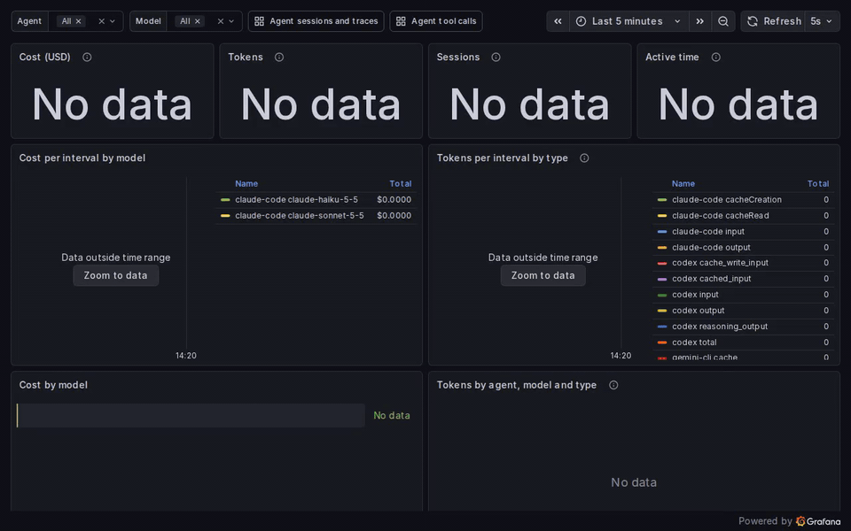
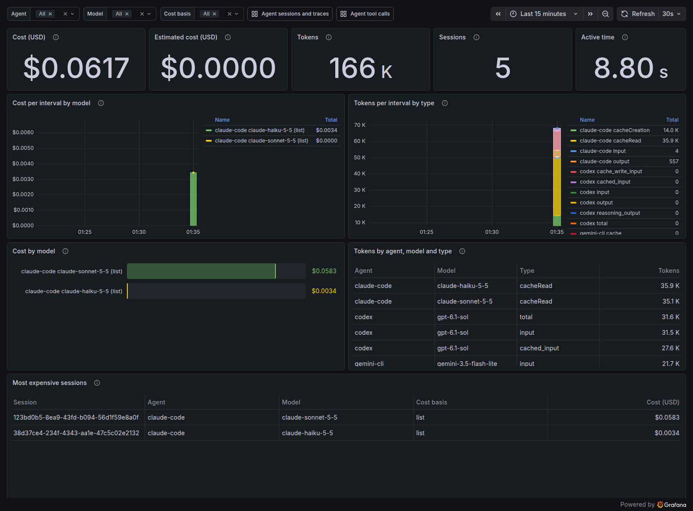
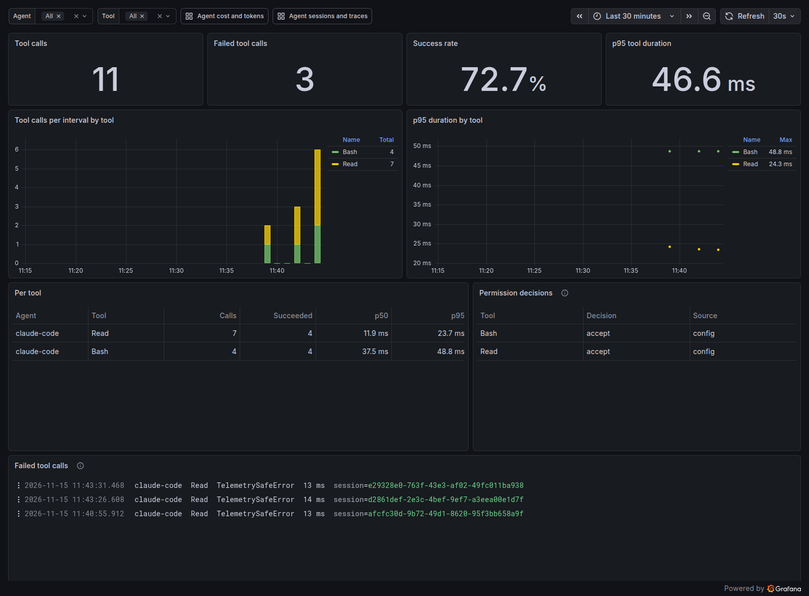
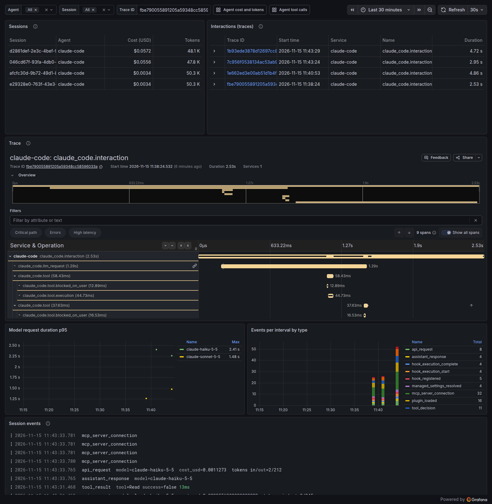
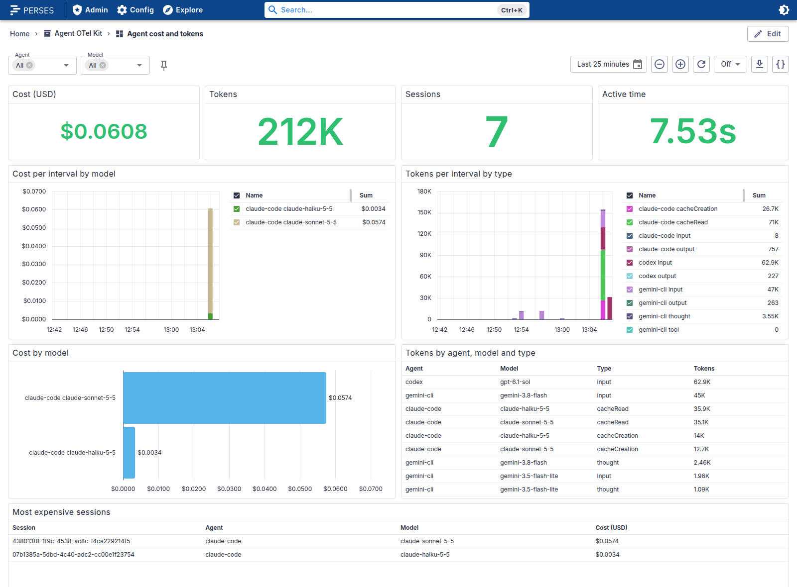

# agent-otel-kit

> 本文为 AI 辅助翻译，以 [English README](README.md) 为准；发现问题欢迎提 issue 或 PR。
> This is an AI-assisted translation; the [English README](README.md) is authoritative.

只需一条 `docker compose up`，即可在你自己的机器上查看 Claude Code、Codex 和 Gemini CLI 的费用、token、工具调用和链路（traces）。



[English](README.md) · [한국어](README.md#한국어)

agent-otel-kit 是一套面向 AI 编程 agent 的本地 OpenTelemetry 栈：一个接收 agent OTLP 遥测数据的 OpenTelemetry Collector，用于指标（metrics）的 Prometheus，用于事件（events）的 Loki，用于链路（traces）的 Tempo，以及在 Grafana 和 Perses 中各一份、内容相同的三个仪表盘。一个小型 Go CLI 负责把每个 agent 指向采集器（collector），并检查数据是否到达。

## 快速开始（30 秒）

前提条件：带 compose 插件的 Docker，以及本项目的 CLI（见[安装 CLI](#安装-cli)）。

```sh
git clone https://github.com/s3onghyun/agent-otel-kit && cd agent-otel-kit
docker compose up -d                       # 或：make up
brew install s3onghyun/tap/agent-otel-kit  # 或使用 release 压缩包、go install、make build
agent-otel-kit setup claude                # 或 codex、gemini、all
# 启动一个新的 agent 会话并使用一分钟左右，然后：
agent-otel-kit doctor
```

在 <http://localhost:3000> 打开 Grafana（允许匿名只读访问；仪表盘位于 "Agent OTel Kit" 文件夹）。如需 Perses，运行 `docker compose --profile perses up -d` 并打开 <http://localhost:8080>。

所有端口都只绑定在 127.0.0.1。collector 监听 `localhost:4318`（OTLP/HTTP）和 `localhost:4317`（OTLP/gRPC）。

### 安装 CLI

- Homebrew（macOS、Linux）：`brew install s3onghyun/tap/agent-otel-kit`
- 适用于 Linux 和 macOS（amd64、arm64）的预编译压缩包，附带 `checksums.txt`：[Releases](https://github.com/s3onghyun/agent-otel-kit/releases)
- Go 1.24+：`go install github.com/s3onghyun/agent-otel-kit/cmd/agent-otel-kit@latest`
- 在克隆的仓库中：`make build` 会生成 `bin/agent-otel-kit`

`agent-otel-kit version` 会输出版本号、commit 和构建日期。

## 采集什么、不采集什么

采集：开启遥测后每个 agent 导出的指标、事件和链路：费用（仅 Claude Code）、按类型划分的 token 数、会话、活跃时间、工具调用（含名称、是否成功、耗时和权限决定）、模型请求耗时，以及每个 prompt、模型请求和工具调用对应的 trace span。

默认不采集：

- prompt 文本、模型回复、工具参数、工具输出、文件路径、shell 命令和错误信息（包括 `error.message` 和 span 异常信息，其中可能含有文件路径）。除非你主动开启（`OTEL_LOG_USER_PROMPTS`、`OTEL_LOG_TOOL_DETAILS`、Codex `log_user_prompt`、Gemini `logPrompts`），agent 本身已经会隐去其中大部分内容。collector 会在 `transform/redact` 中再次删除这些属性，因此即使误开了上述某个 agent 开关，内容也不会被存储。如需保留，在 collector 的环境变量中设置 `AGENT_OTEL_KIT_CAPTURE_CONTENT=true`。
- 进程命令行（`process.command_args`）。Gemini CLI 将其作为 resource 属性发送，而对于 `gemini -p "..."`，其中包含 prompt。
- `user.email`。Claude Code 会在每个数据点上附加账户邮箱，Gemini CLI 的文档也说明使用 Google 登录时同样如此（使用 API key 时它没有发送）；除非设置 `AGENT_OTEL_KIT_KEEP_EMAIL=true`，collector 会将其删除。
- 由于 Gemini CLI 默认记录 prompt，`setup gemini` 会设置 `logPrompts: false`。

保留的其他标识符：`session.id`（Codex：`conversation.id`）、`user.account_uuid`、`organization.id`、Codex `user.account_id`、`installation.id`、`terminal.type`、主机名和操作系统。所有数据都留在你的机器上；栈中没有任何组件把数据发往别处（Grafana 和 Loki 的使用情况上报已关闭）。

## 各 agent 的配置

`setup` 只修改该 agent 自己的用户配置文件。首次运行时会把原文件保存到 `~/.agent-otel-kit/backups/`；`setup --undo <agent>` 会按原样恢复原始字节和权限，或删除 setup 创建的文件（以及目录）。如果你在 setup 之后编辑过该文件，除非传入 `--force`，否则 undo 会拒绝执行。`--dry-run` 只输出结果而不写入。`--endpoint` 可让 agent 指向其他位置的 collector（默认 `http://localhost:4318`）。

| Agent | 文件 | setup 写入的内容 |
|---|---|---|
| Claude Code | `~/.claude/settings.json`（支持 `$CLAUDE_CONFIG_DIR`） | `env`：`CLAUDE_CODE_ENABLE_TELEMETRY=1`、用于指标和日志的 OTLP exporter、`OTEL_EXPORTER_OTLP_ENDPOINT`、`http/protobuf`、10 s 的指标间隔，以及 traces beta（`OTEL_TRACES_EXPORTER=otlp`、`CLAUDE_CODE_ENHANCED_TELEMETRY_BETA=1`；用 `--no-traces` 跳过） |
| Codex | `~/.codex/config.toml`（支持 `$CODEX_HOME`） | `[otel]` 下一个带标记的块：`exporter`、`trace_exporter` 和 `metrics_exporter` 设为 `otlp-http`，并使用 `/v1/logs`、`/v1/traces`、`/v1/metrics` URL，`log_user_prompt = false`；其他 `[otel]` 键和文件的其余部分保持不变 |
| Gemini CLI | `~/.gemini/settings.json` | `telemetry`：`enabled`、`target: "local"`、`otlpEndpoint`、`otlpProtocol: "http"`、`logPrompts: false`；删除会覆盖 endpoint 的 `outfile` |

带注释的配置文件不会被修改（setup 会报错退出）；这种情况下请手动添加该配置块。

支持的版本：

| Agent | 状态 |
|---|---|
| Claude Code 2.1.325 | 已在实际运行的栈上验证：指标、事件和链路（需开启 traces beta 标志）。 |
| Codex 0.169.0（`codex exec`） | 已用 `setup codex` 在实际运行的栈上验证：指标、事件和链路。token 来自 `codex.turn.token_usage` 直方图，会话来自 `codex.thread.started`，工具调用来自 `codex.tool_result` 事件。没有费用指标。Codex 的指标不带会话 ID，因此按会话的表格中没有 Codex 会话。 |
| Gemini CLI 0.68.0（`gemini -p`，API key） | 已用 `setup gemini` 在实际运行的栈上验证：指标、事件和链路。工具调用来自 `gemini_cli.tool_call` 事件。没有费用指标。 |

只测试了非交互模式和上面列出的认证方式。使用个人 Google 登录时，Google 拒绝了此客户端的 Gemini CLI（"no longer supported for Gemini Code Assist for individuals"），因此该路径改用 AI Studio API key 测试。

## delta temporality 陷阱

Claude Code、Codex 和 Gemini CLI 默认以 delta temporality 导出计数器（每次导出只携带自上次以来的增量），而 Prometheus 只存储累积（cumulative）计数器，所以直接的 OTLP 到 Prometheus 路径会丢弃或误读这些数据。collector 的 `delta_to_cumulative` processor 在 Prometheus exporter 之前为每个序列维护累计总数，因此 agent 可以保留默认设置。

`compose.yaml` 中两个相关的 Prometheus 设置：`created-timestamp-zero-ingestion` 在序列开始时插入一个零值样本，使短会话的第一次导出也能被计入；`promql-extended-range-selectors` 启用 `increase(x[$__range] anchored)`，仪表盘用它得到精确的总数，避免 `increase()` 的外推。

## 仪表盘

三个仪表盘在 Grafana（`grafana/dashboards/`）和 Perses（`perses/provisioning/dashboards/`）中都有。两者都由 `tools/gendashboards` 中的同一份面板列表生成（`make dashboards`）；如果提交的 JSON 与生成结果不一致，CI 会失败。

**Agent cost and tokens**：所选时间范围内的费用、token、会话和活跃时间；按模型划分的每区间费用；按类型划分的每区间 token；按模型划分的费用；按 agent、模型和类型划分的 token；费用最高的会话。



**Agent tool calls**：调用次数、失败次数、成功率和 p95 耗时；按工具划分的每区间调用次数和 p95 耗时；按工具的表格；权限决定（谁允许了每次调用）；来自 Loki 的失败调用。工具指标 `agent_otel_kit.tool.duration` 由 collector 中的 `signal_to_metrics` connector 根据每个 agent 的工具结果事件生成，因此对所有 agent 都一致。



**Agent sessions and traces**：按会话的费用和 token、来自 Tempo 的交互链路、链路瀑布图（把 trace ID 粘贴到 Trace ID 输入框中）、模型请求耗时、按类型的事件速率，以及所选会话的事件流。



所有标签都统一为 `agent_name`（`claude-code`、`codex`、`gemini-cli`），由每个 agent 设置的 `service.name` 推导而来。在 agent 上设置 `OTEL_RESOURCE_ATTRIBUTES=agent.name=<name>` 可以覆盖它。Claude Code 自己的 `agent.name` 属性（subagent 名称）和 Codex 的 `agent_name` 属性（agent 路径，主 agent 为 `/root`）保留为 `subagent.name`。Codex 的 `conversation.id` 被复制到 `session.id`，其 `token_type` 被复制到 `type`。

token 总数（Tokens 统计值和按会话的 Tokens 列）只累加互不重叠的 token 类型：Codex 把缓存输入计入 `input`、把 reasoning 计入 `output`，Gemini CLI 把 `cache` 计入 `input`，因此这些部分（以及 Codex 的 `total`）不会被重复累加。Claude Code 的 `cacheRead` 和 `cacheCreation` 与 `input` 相互独立，会被累加。按类型的细分面板显示所有类型，包括重叠的类型。

仪表盘上可见的 agent 差异：

- Codex 会把已运行但以非零状态退出的 shell 命令记为成功的工具调用。在 code mode 下，它还会在每个内部 `exec_command` 旁边报告外层的 `exec` 工具。
- Codex 会发送许多短小的内部链路（`auth`、`fs.read_file`……）；链路面板对 Codex 只列出 `turn/start`。Gemini CLI 没有按 prompt 的链路：它为每次模型调用发送一条 `llm_call` 链路，为每批工具调用发送一条 `schedule_tool_calls` 链路。
- 在默认的 WebSocket 传输下，Codex 不记录每个请求的模型耗时，因此模型请求面板只显示 Codex 的 HTTP `/responses` 请求。

在 Prometheus 中看到的、来自 Claude Code 2.1.325 的指标名：`claude_code_cost_usage_USD_total`、`claude_code_token_usage_tokens_total`、`claude_code_session_count_total`、`claude_code_active_time_seconds_total`。来自 Codex 0.169.0（一次简短的 `codex exec` 运行中出现 74 个指标族），其中包括：`codex_turn_token_usage_{bucket,count,sum}`（标签 `token_type`）、`codex_thread_started_total`、`codex_tool_call_total`、`codex_turn_e2e_duration_ms_milliseconds_*`。来自 Gemini CLI 0.68.0：`gemini_cli_token_usage_total`（标签 `type`：`input`、`output`、`thought`、`cache`、`tool`）、`gemini_cli_session_count_total`、`gemini_cli_tool_call_count_total`、`gemini_cli_api_request_count_total`。来自 collector：`agent_otel_kit_tool_duration_milliseconds_{bucket,count,sum}`。

在 Loki 中看到的事件名：Claude Code `tool_result`、`tool_decision`、`api_request`、`user_prompt`……；Codex `codex.tool_result`、`codex.tool_decision`、`codex.sse_event`、`codex.api_request`、`codex.user_prompt`……；Gemini CLI `gemini_cli.tool_call`、`gemini_cli.api_request`、`gemini_cli.api_response`、`gemini_cli.file_operation`、`gemini_cli.user_prompt`……。Claude Code 还定义了 `claude_code.lines_of_code.count`、`claude_code.commit.count`、`claude_code.pull_request.count` 和 `claude_code.code_edit_tool.decision`，它们只在发生编辑、commit 或 pull request 后才会出现。

截图取自这套栈，数据来自在作者机器上运行的真实会话：Claude Code（`make demo`）、`codex exec` 和 `gemini -p`，然后运行 `make screenshots`。顶部的演示 GIF 是在一次这样的运行期间用 headless Chromium 录制的同一组仪表盘，只做了裁剪和加速；`docs/demo.mp4` 是其原始文件。

## Perses

```sh
docker compose --profile perses up -d      # 或：make up-perses
```

Perses 在 <http://localhost:8080> 启动，带有项目 `agent-otel-kit`、Prometheus、Loki 和 Tempo 的全局数据源以及三个仪表盘，全部从 `perses/provisioning/` 加载（每 30 s 重新读取一次）。这些仪表盘是普通的 Perses 资源（`kind: Dashboard`），也可以用 `percli apply -d perses/provisioning/dashboards/` 应用到其他 Perses 服务器。



## 故障排查

- `agent-otel-kit doctor` 每项检查输出一行：栈的健康状态、collector 是否收到了数据（依据它自身的 `otelcol_receiver_accepted_*` 计数器）、哪些 `agent_name` 值在 Prometheus 中有指标，以及每个 agent 的配置是否指向 collector。
- `docker compose up` 之后的最多一分钟内，Loki 和 Tempo 会返回 503。
- 没有数据到达：遥测设置在 agent 启动时读取，所以 `setup` 之后要启动一个新会话。`OTEL_EXPORTER_OTLP_ENDPOINT` 之类的 shell 变量可能指向别处；doctor 会对此发出警告。Claude Code 会忽略项目级 `.claude/settings.json` 中的 OTel exporter 变量。
- 指标到达较晚：除非设置了 `OTEL_METRIC_EXPORT_INTERVAL`，Claude Code 每 60 s 导出一次指标（setup 设置为 10 s）；事件和 span 每 5 s 导出一次。
- 没有来自 Claude Code 的链路：traces beta 需要 `CLAUDE_CODE_ENHANCED_TELEMETRY_BETA=1` 和 `OTEL_TRACES_EXPORTER=otlp`。
- 要查看原始数据，用 `make up-debug` 启动，然后运行 `docker compose logs -f otel-collector`。
- `make test-collector` 用从 Codex 和 Gemini CLI 录制的 payload（位于 `collector/testdata/`）运行 collector 配置，并检查标准化、工具直方图和脱敏处理。
- 重启 collector 会重置其 delta-to-cumulative 状态；仪表盘会将其视为计数器重置。
- 内存上限：collector、Prometheus、Loki 和 Tempo 各 512 MiB，Grafana 384 MiB，Perses 256 MiB。
- `make clean` 会停止栈并删除其数据卷。

## 目录结构

```
compose.yaml               the stack (Perses under --profile perses)
collector/config.yaml      receivers, processors, connector, exporters
prometheus/ loki/ tempo/   backend configs
grafana/                   datasources and dashboards
perses/                    Perses config and provisioning
cmd/agent-otel-kit/        CLI: setup, setup --undo, doctor, version
.goreleaser.yaml           release builds (a vX.Y.Z tag runs .github/workflows/release.yml)
tools/gendashboards/       generates the Grafana and Perses dashboards
scripts/                   demo.sh (real claude -p sessions), screenshots.sh,
                           test-collector.sh (collector rules on recorded payloads),
                           check-collector-warnings.sh (collector start-up warnings)
```

## 开发

提交 pull request 前要运行的检查，以及修改 collector 配置时的检查清单：[CONTRIBUTING.md](CONTRIBUTING.md)。

许可证：Apache-2.0。
